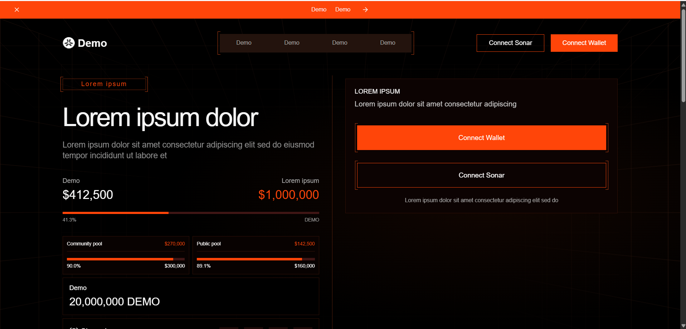
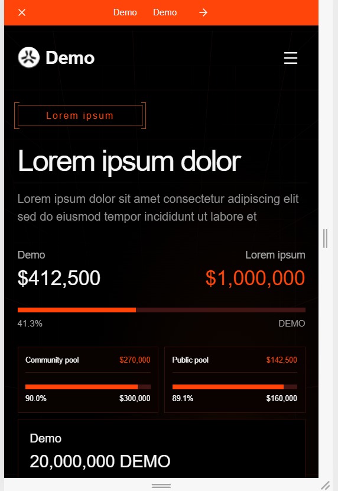
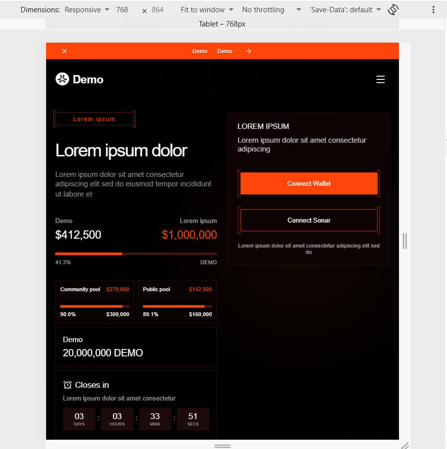

# Screen 01 — Next.js IDO demo

Next.js App Router + TypeScript, Tailwind CSS 4, shadcn-style Radix Dialog and Button components, lucide-react, Framer Motion, TanStack Query, sonner, clsx, tailwind-merge and CVA.

## Screenshots

### Desktop



### Mobile



### Tablet



## Run

Requires Node.js 22.13 or newer (Node.js 24 recommended).

```sh
npm ci
npm run dev
```

Open http://localhost:3000.

```sh
npm run typecheck
npm run lint
npm test
npm run build
npm start
```

## Structure

- `src/components/sections/`: top banner, navbar, hero, sale card, partners, timeline/details, resources, footer.
- `src/components/ui/`: reusable shadcn-compatible Radix dialog and CVA button.
- `src/components/connect-dialog.tsx`: placeholder wallet and Sonar dialogs.
- `src/app/api/sale/route.ts`: all mock sale amounts, pools, dates, timeline and details.
- `src/hooks/use-sale.ts`: TanStack Query fetching, timeout, cancellation, schema validation and retry.
- `src/hooks/use-clock.ts`: one shared clock, cleaned up when unused; re-syncs after tab focus/visibility changes.
- `src/lib/sale.ts`: validated sale schema, capped progress and countdown calculations.
- `public/assets/`: locally saved brand and partner artwork from the supplied reference.

## Behavior

Sale data comes exclusively from `GET /api/sale`. Query states include a shimmer loader, retryable error, empty state and refresh-error message while retaining the last valid data. Progress is clamped to 0–100%; dates and amounts are validated before rendering. Requests time out after 15 seconds. The countdown stops at zero, and refresh does not reset the deadline.

The partner logos have an extra slow, seamless left-to-right animation. The loading state also uses a shimmer UI concept so the page gives visual feedback while sale data is fetched. Animation respects the system's reduced-motion setting.

The default deadline is generated once when the mock API module starts. For a stable deadline across restarts/instances, set `MOCK_SALE_OPENS_AT` and `MOCK_SALE_CLOSES_AT` to valid ordered ISO timestamps in `.env.local`.

Try these states:

- `/?scenario=slow`: delayed mock response to inspect the loading skeleton.
- `/?scenario=error`: HTTP 503 and retry UI.
- `/?scenario=empty`: no current sale.
- `/?scenario=expired`: expired countdown.

The mock scenarios intentionally persist across retry. Return to `/` for normal data.

Both connection buttons open accessible Radix dialogs with focus trapping, Escape dismissal and focus restoration. Continue shows a sonner demo toast. Resource links open local placeholder documents. Newsletter submission validates the email in the browser, displays a toast, and sends/stores nothing. Social links go to the providers' homepages as placeholders.

## Optional browser checks

After `npm run build`, install Playwright for local verification:

```sh
npm install --no-save playwright
npx playwright install chromium
npm run verify:browser
```

The verification script starts and stops its own production server on port 3001.

## Design notes

The perspective grid is confined to the hero section and scrolls away with it. The connection card has an orange radial glow around and below it; later page sections use the black page background. Styling is implemented with Tailwind CSS 4 utilities in `src/lib/ui-styles.ts`, with theme tokens and animation keyframes in `src/app/globals.css`.

Built from the supplied Screen 01 screenshot and CSS export (1698px desktop reference). It preserves the black background, orange `#FF4509`, dark perspective grid, fine borders, bracket details, two-column layout, partner strip and oversized footer wordmark. Mobile reflows the layout rather than shrinking the desktop frame.

The source uses the reference's placeholder copy, with meaningful connection/resource labels and numeric mock sale data. Arial/Helvetica are explicit font fallbacks and the grid is recreated in CSS. The partner strip uses the supplied SVG logos. No full-screen screenshot is used as the implementation.

## Verification

Production build, TypeScript, ESLint and unit tests pass. Headless Chromium checks covered 375/768/1024/1440/1698px widths without horizontal overflow, runtime errors, wallet/Sonar dialogs, focus trapping/restoration, Escape, live countdown, mobile navigation, slow/error/empty/expired states, resource dialog and toast behavior.

No real Web3, payments, database, credentials, or external sale API is used.
